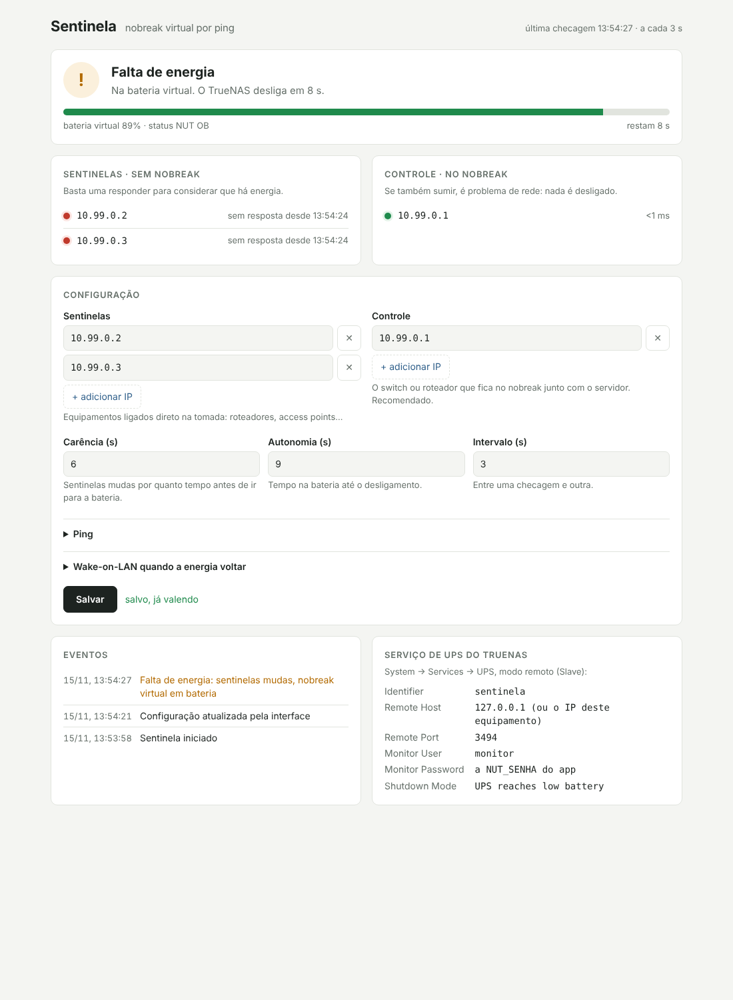

# sentinela

Um **nobreak virtual** que detecta falta de energia por ping e faz o TrueNAS
(ou qualquer cliente NUT) desligar com segurança, **sem precisar de nobreak
com USB**.

## Como funciona

- **Sentinelas** são equipamentos de rede ligados **direto na tomada**, sem
  nobreak (roteadores, access points, uma TV...). Quando a luz cai, eles somem
  da rede.
- O **controle** é um equipamento que está **no nobreak** junto com o
  servidor, normalmente o switch ou roteador por onde o NAS passa.
- O sentinela publica o estado como um nobreak de verdade pelo protocolo
  [NUT](https://networkupstools.org/) (porta 3493). O serviço de UPS do
  próprio TrueNAS, em modo remoto, enxerga esse "nobreak" e desliga o servidor
  do jeito oficial.

| Situação | Status publicado | O que acontece |
|---|---|---|
| Alguma sentinela responde | `OL` (na rede) | nada |
| Todas mudas há mais que `CARENCIA` | `OB` (na bateria) | alerta no TrueNAS |
| Mudas há `CARENCIA` + `AUTONOMIA` | `FSD OB LB` (bateria baixa) | TrueNAS desliga |
| Sentinelas **e** controle mudos | (congela) | nada: é problema de rede, não de luz |
| Nenhuma sentinela configurada | `OL` | nada |

Basta **uma** sentinela responder para considerar que há energia. Por isso um
roteador reiniciando para atualização não desliga nada. A carga
(`battery.charge`) cai de 100 a 0 durante a autonomia, então o TrueNAS mostra
uma "bateria" descendo.

## Interface web



Na porta **8493** fica uma página com o estado ao vivo (cada IP com latência
ou "sem resposta desde…", a bateria virtual e o histórico de eventos) e a
configuração: sentinelas, controle, carência, autonomia, intervalo, ping e
Wake-on-LAN. O que você salva passa a valer **na hora, sem reiniciar**, e fica
em `/config/sentinela.json`. Campos definidos nas variáveis de ambiente do
app aparecem travados, com a etiqueta `APP`.

### Tempos

O tempo até o desligamento se divide em duas fases, cada uma configurável:

1. **Até entrar em modo bateria:** quanto tempo as sentinelas ficam mudas
   antes de contar como falta de luz. Serve para ignorar um piscar de energia.
2. **Em modo bateria até desligar:** quanto tempo esperar a luz voltar. Quando
   acaba, o sentinela sinaliza bateria baixa e o TrueNAS desliga.

Informe também quanto o seu nobreak aguenta e quanto o NAS leva para
desligar. A interface desenha a linha do tempo no pior caso (a falta só é
percebida na checagem seguinte) e avisa se o nobreak acaba antes de o NAS
terminar de desligar, sugerindo o máximo de tempo em modo bateria. Para medir
o tempo de desligamento, desligue o TrueNAS uma vez pela interface e
cronometre.

O navegador pede usuário e senha: o usuário pode ser qualquer um, e a senha é
a `NUT_SENHA`, ou a `UI_SENHA` se você definir uma separada.

No TrueNAS, a página abre pelo botão **Web UI** na página do app.

## Instalação no TrueNAS

**De onde vem a configuração:** variável de ambiente definida no app (pelo
formulário ou pelo YAML) **manda**, e aparece travada na interface web com a
etiqueta `APP`. O que você não definir pode ser ajustado pela interface web.
Tempos aceitam segundos (`90`) ou unidades (`90s`, `2min`, `1m30s`).

Há dois jeitos de instalar. Escolha um.

### Opção A: formulário do TrueNAS (Custom App)

Configuração em campos do próprio TrueNAS, sem editar texto.

**Apps → Discover Apps → Custom App** e preencha:

| Seção | Campo | Valor |
|---|---|---|
| Image | Repository / Tag | `ghcr.io/leonardok/sentinela` / `latest` |
| Environment Variables | Name / Value (Add para cada) | veja a tabela abaixo |
| Ports | Container Port / Host Port | `3493`→`3493` TCP e `8493`→`8493` TCP |
| Storage | Type ixVolume, Mount Path | `/config` |
| Portal Configuration | Name, Protocol, Use Node IP, Port, Path | `Web UI`, HTTP, marcado, `8493`, `/` |
| Capabilities | Add | `NET_RAW` |
| Restart Policy | | Unless Stopped |

Variáveis de ambiente:

| Name | Exemplo de Value |
|---|---|
| `NUT_SENHA` | uma senha (obrigatória) |
| `SENTINELAS` | `192.168.1.2,192.168.1.3` |
| `CONTROLE` | `192.168.1.1` |
| `CARENCIA` | `30s` (até entrar em modo bateria) |
| `AUTONOMIA` | `1m30s` (em modo bateria até desligar) |
| `NOBREAK_DURACAO` | `5min` (opcional, só para a conta da interface) |
| `TEMPO_DESLIGAR` | `2min` (opcional, idem) |

Para mudar depois, use **Edit** no app e altere as variáveis. O app reinicia
com os valores novos.

### Opção B: YAML (Install via YAML)

**Apps → Discover Apps → ⋮ → Install via YAML** e cole o
[`compose/truenas.yaml`](compose/truenas.yaml), que traz todas as opções
comentadas. Para mudar depois, **Edit** no app e edite o texto.

O botão Web UI vem do bloco `x-portals` e só é criado na **instalação**.
Adicionado depois numa edição, o botão não aparece: apague e instale de novo.
Sem o botão, a página continua em `http://IP-DO-TRUENAS:8493`.

### Depois de instalar (as duas opções)

1. **Abra o Web UI** e confira se os pontos das sentinelas e do controle
   ficam verdes e se a linha do tempo fecha com o seu nobreak.
2. **System → Services → UPS**, configure e ative o serviço. Os nomes dos
   campos podem variar um pouco entre versões do TrueNAS (a própria interface
   do sentinela mostra estes valores):

   | Campo | Valor |
   |---|---|
   | UPS Mode | **Slave** (remoto/secundário) |
   | Identifier | `sentinela` |
   | Remote Host | `127.0.0.1` |
   | Remote Port | `3493` |
   | Monitor User / Password | os mesmos de `NUT_USUARIO` / `NUT_SENHA` |
   | Shutdown Mode | **UPS reaches low battery** |

   Com "UPS reaches low battery", quem decide o momento de desligar é o
   sentinela (carência + autonomia). Se preferir, "UPS goes on battery" +
   Shutdown Timer também funciona, mas aí o timer do TrueNAS manda.
3. Confira no Shell do TrueNAS: `upsc sentinela@127.0.0.1` deve mostrar
   `ups.status: OL`.

Para testar sem desligar nada, deixe o serviço de UPS desativado e
acompanhe a interface enquanto tira as sentinelas da tomada.

## Variáveis de ambiente

Fixas, só pelo YAML:

| Variável | Padrão | Descrição |
|---|---|---|
| `NUT_SENHA` | (obrigatória) | senha do usuário NUT e, por padrão, da interface |
| `NUT_USUARIO` | `monitor` | usuário NUT |
| `UI_SENHA` | = `NUT_SENHA` | senha da interface web, se quiser outra |
| `UPS_NOME` | `sentinela` | nome do nobreak virtual |
| `PORTA` / `UI_PORTA` | `3493` / `8493` | portas do NUT e da interface |
| `LOG_NIVEL` | `INFO` | `DEBUG` para ver cada checagem |

Também editáveis na interface web, **a não ser que estejam definidas no app**:
definidas aqui, elas mandam e ficam travadas na interface. Tempos aceitam
unidades (`90s`, `2min`, `1m30s`):

| Variável | Padrão | Descrição |
|---|---|---|
| `SENTINELAS` | vazio | IPs ou nomes sem nobreak, separados por vírgula |
| `CONTROLE` | vazio | IPs no nobreak; se todos sumirem, nada acontece |
| `CARENCIA` | `30` | segundos sem sentinelas até o modo bateria (`OB`) |
| `AUTONOMIA` | `90` | segundos em modo bateria até a bateria baixa, quando o TrueNAS desliga |
| `NOBREAK_DURACAO` | `0` | quanto seu nobreak aguenta, só para a conta da interface |
| `TEMPO_DESLIGAR` | `120` | quanto o NAS leva para desligar, só para a conta da interface |
| `INTERVALO` | `15` | segundos entre checagens |
| `PING_TIMEOUT` / `PING_TENTATIVAS` | `2` / `2` | por IP, a cada checagem |
| `WOL_MACS` | vazio | MACs para acordar quando a energia volta |
| `WOL_BROADCAST` | `255.255.255.255` | endereço de broadcast |
| `WOL_INTERVALO` / `WOL_DURACAO` | `120` / `1800` | repete o WoL por 30 min |
| `WOL_AO_INICIAR` | `false` | começa mandando WoL ao ligar |

## Religar quando a luz volta

Com o servidor desligado, nenhum app roda nele. Como o nobreak segurou a
energia o tempo todo, a opção "Restore on AC Power Loss" da BIOS também não
dispara. Você tem três caminhos:

- **Um roteador fora do nobreak manda Wake-on-LAN ao ligar.** Exemplo no
  MikroTik:
  `/system scheduler add name=acorda-nas start-time=startup interval=5m on-event="/tool wol mac=AA:BB:CC:DD:EE:FF interface=bridge"`.
  No OpenWrt: `sleep 180; etherwake -i br-lan AA:BB:CC:DD:EE:FF` no
  `/etc/rc.local`.
- **Um segundo sentinela num Raspberry Pi fora do nobreak**, com
  [`compose/raspberry-pi.yaml`](compose/raspberry-pi.yaml). Ele liga com a
  energia e manda WoL repetidas vezes ("Mandar também ao ligar"), e também
  quando detecta a volta da energia depois de uma falta. O MAC do NAS se
  configura na seção Wake-on-LAN da interface.
- Deixar o nobreak descarregar até cortar a saída, e a BIOS religa o PC.

Repetir o WoL cobre o caso em que a luz volta enquanto o NAS ainda está
desligando. No servidor, ative Wake-on-LAN na BIOS e desative ErP/EuP.

## Desenvolvimento

```sh
python3 -m unittest -v          # estado, validação, persistência e API
docker build -t sentinela .
docker run --rm -e NUT_SENHA=x -p 3493:3493 -p 8493:8493 sentinela
# abra http://localhost:8493 (senha x)
upsc sentinela@127.0.0.1
```

A cada push na `main`, o GitHub Actions roda os testes e publica a imagem em
`ghcr.io/leonardok/sentinela` para amd64, arm64 e armv7.

## Licença

GPL-3.0
